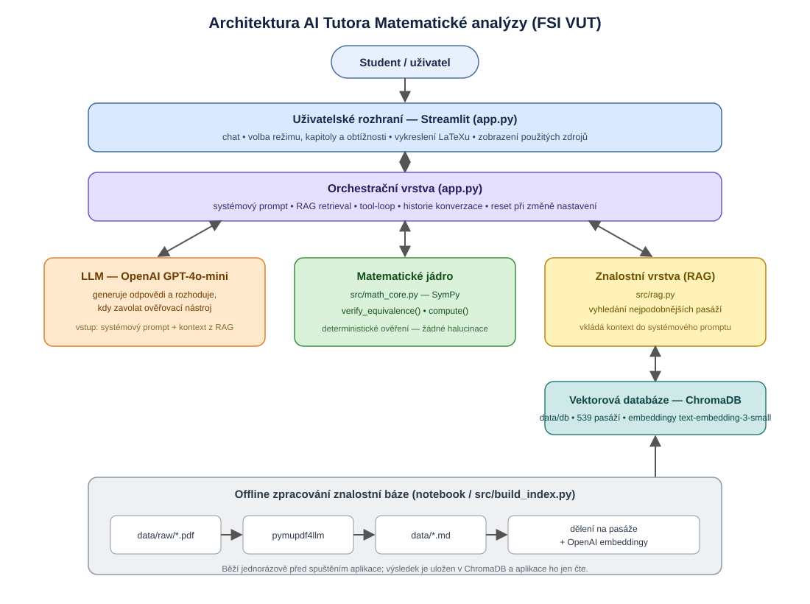

# AI Tutor Matematické analýzy (FSI VUT) — dokumentace

Semestrální projekt SIS — varianta 2.
Autor: Josef Blažek.

- **Živá aplikace (deployment):** https://sissemestralniprojekt-8dgvdwadhjoz59f8ewu5km.streamlit.app/
- **Ukázky reálných konverzací:** `docs/ukazky_konverzaci.md`
- **Diagram architektury:** `docs/architektura.svg`

---

## 1. Úvodní část

### 1.1 Cíl projektu
Cílem projektu je navrhnout a zprovoznit specializovaného matematického chatbota
(„AI Tutora“) pro předměty Matematická analýza I a II na FSI VUT v Brně. Aplikace
umožňuje studentovi **vysvětlovat teorii** (režim *Učitel*), **procvičovat příklady**
(režim *Zkoušející*) a nechat si látku vysvětlit **neformálně a na přirovnáních** (režim
*Spolužák*). Klíčovým požadavkem je, aby systém **nepočítal zpaměti**, ale každý
výsledek ověřoval **deterministickým matematickým nástrojem** (SymPy), a aby se odpovědi
opíraly o **reálné přednáškové texty** (RAG), nikoliv o „vymýšlení“ jazykového modelu.

### 1.2 Motivace
Výuka matematiky klade důraz na přesnost a korektní postup. Jazykové modely sice plynule
vysvětlují, ale u výpočtů často halucinují (špatné derivace, integrály, znaménka). Kombinací
LLM s deterministickým ověřovačem a s vyhledáváním v přednáškách vzniká nástroj, který je
současně **srozumitelný** i **matematicky spolehlivý** a je dostupný studentům odkudkoliv
přes webové rozhraní.

### 1.3 Použité technologie
| Vrstva | Technologie |
| --- | --- |
| Uživatelské rozhraní | Streamlit (Python) |
| Jazykový model | OpenAI GPT‑4o‑mini (`openai`) |
| Matematická verifikace | SymPy (`sympy`) |
| Vykreslování grafů | Plotly + NumPy (`plotly`, `numpy`) |
| Znalostní báze / RAG | ChromaDB (`chromadb`) + OpenAI embeddingy `text-embedding-3-small` |
| Zpracování PDF | `pymupdf4llm` (PDF → Markdown) |
| Konfigurace | `python-dotenv` (`.env`) |
| Správa závislostí | `uv` (`pyproject.toml`, `uv.lock`) |

### 1.4 Zdroje / literatura
- Přednáškové texty FSI VUT: *Matematická analýza I* a *Matematická analýza II*
  (dodané ve formátu PDF — `data/raw/*.pdf`).
- Dokumentace OpenAI API, SymPy, ChromaDB, Streamlit a pymupdf4llm.

---

## 2. Technická část

### 2.1 Architektura systému



*(zdroj diagramu pro Mermaid je v `docs/architektura.mmd`)*

Systém se skládá ze čtyř logických vrstev odpovídajících zadání:

1. **Znalostní vrstva (Data & Knowledge Layer)**
   Přednášková PDF se převedou na Markdown, rozdělí na pasáže, obodují embeddingy
   a uloží do ChromaDB (`data/db`). Nad touto databází běží vyhledávání (RAG).
2. **Matematické jádro (Math & Verification Core)**
   Modul `src/math_core.py` zpřístupňuje dvě funkce: `compute` (přímý symbolický výpočet –
   derivace, integrál, limita, úpravy) a `verify_equivalence` (ověření algebraické
   ekvivalence dvou výrazů).
3. **Orchestrační vrstva (Orchestration Layer)**
   V `app.py` sestavuje systémový prompt, načítá RAG kontext, řídí smyčku volání nástrojů
   (tool‑loop), udržuje historii konverzace a hlídá pedagogická pravidla.
4. **Uživatelské rozhraní**
   Streamlit aplikace s chat jednotkou, postranním panelem pro volbu režimu, kapitoly a
   obtížnosti a s rozbalovacími panely pro použité zdroje a protokol ze SymPy.

### 2.2 Zpracování PDF / LaTeX materiálů (pipeline)
Reprodukovatelná pipeline je v notebooku `src/Semestralni_projekt.ipynb`:

1. **PDF → Markdown**: `pymupdf4llm.to_markdown()` převede přednášková PDF na Markdown se
   zachováním nadpisů, vzorců a matematického zápisu. Výstup: `data/mat-analyza-*.md`.
2. **Dělení na pasáže (chunking)**: `src/rag.py` dělí Markdown nejprve podle nadpisů
   (sekcí), dlouhé sekce pak podle odstavců; extrémně dlouhé odstavce se dělí po znacích
   s mírným přesahem (`OVERLAP`). Každá pasáž si nese **nadpis sekce** (kvůli kontextu)
   a **název zdrojového souboru** (kvůli dohledatelnosti). Parametry: `MAX_CHARS = 1500`,
   `OVERLAP = 250`.
3. **Embeddingy + uložení**: z pasáží se přes OpenAI `text-embedding-3-small` spočítají
   vektory a uloží se do kolekce `mat_analyza` v persistentní ChromaDB (`data/db`).
   Celkem **539 pasáží**.
4. **Strukturování podle kapitol a obtížnosti**: osnova předmětů je v `src/curriculum.py`
   (8 okruhů). Obtížnost se volí v UI a promítá se do systémového promptu.

Sestavení indexu se spouští jednorázově:

```bash
uv run python -m src.build_index            # postaví index, pokud neexistuje
uv run python -m src.build_index --rebuild  # přegeneruje od nuly
```

### 2.3 Princip RAG
Při každém dotazu studenta `src/rag.py` (`Retriever.retrieve`) najde v ChromaDB `k = 4`
nejpodobnější pasáže. Ty se vloží jako **druhá systémová zpráva** do promptu spolu s
pokynem, aby model vycházel především z nich. Student si může načtené pasáže zobrazit
v rozbalovacím panelu *„Použité pasáže z přednášek (RAG)“*, takže je vidět, z čeho odpověď
vychází. Pokud index neexistuje, aplikace funguje dál (jen bez RAG) a zobrazí upozornění.

> Poznámka: zvolená varianta je **RAG (retrieval‑augmented generation)**, nikoliv fine‑tuning.
> RAG jsme zvolili proto, že je levnější, okamžitě reflektuje změny ve skriptech a umožňuje
> u odpovědí citovat zdroj.

### 2.4 Napojení matematického jádra (SymPy) a vykreslování
Model má k dispozici **tři nástroje**:

- `verify_equivalence(student_expr, expected_expr, variable)` (`src/math_core.py`) – ověří, zda
  jsou dva výrazy algebraicky ekvivalentní (rozdíl se zjednoduší na nulu). Používá se
  k vyhodnocení odpovědi studenta.
- `compute(expr, operation, variable, point, lower, upper)` (`src/math_core.py`) – **přímo spočítá**
  výsledek: derivaci (i druhou), integrál, limitu, zjednodušení, rozvinutí, faktorizaci nebo
  řešení rovnice. U `integrate` bez `lower`/`upper` vrací **neurčitý** integrál (primitivní funkci),
  s oběma mezemi **určitý** integrál. K číselnému výsledku navíc přidává **přibližnou hodnotu**
  (položka `numeric`), kterou model uvede studentovi.
- `plot_function(exprs, variable, x_min, x_max, area_from, area_to, area_index)` (`src/plotting.py`)
  – vykreslí **jednu i více funkcí do jednoho grafu** (Plotly), u určitého integrálu **vybarví
  plochu pod křivkou** (křivku určí `area_index`) a vždy **zvýrazní osy x = 0 a y = 0**.

Modul `src/plotting.py` je navržen robustně i pro „bláznivé“ funkce: husté vzorkování přes
`lambdify`, **percentilový rozsah osy y** (pól neroztáhne měřítko), **přerušení křivky** v místech
skoků (asymptoty se nespojí čarou) a ošetření nedefinovaného oboru (bere se jen reálná část).
Nástroj navíc vrací modelu **číselný souhrn** (obor, min/max, plocha), aby mohl graf okomentovat.

Volání nástrojů jsou **odolná**: argumenty se filtrují podle signatury funkce a každé volání je
obaleno `try/except`, takže ani neplatné argumenty od modelu neshodí aplikaci – vrátí se chybová
zpráva a model může volat znovu.

Volání probíhají ve **smyčce** (`MAX_TOOL_ROUNDS = 5`): konverzace se pošle modelu s definicemi
nástrojů, orchestrační vrstva volání vykoná lokálně přes SymPy (podle názvu funkce přes
`AVAILABLE_FUNCTIONS`), výsledky vrátí modelu jako zprávy typu `tool` a volá znovu, dokud
model nevrátí finální text. Každé volání se zobrazí v panelu *„Ověření výpočtu (SymPy)“*.

```python
def compute(expr, operation, variable="x", point=None):
    x = sp.Symbol(variable)
    e = sp.sympify(expr)
    # operation: simplify | derivative | derivative2 | integrate | limit | expand | factor | solve
    ...
    return {"result": str(res), "latex": sp.latex(res), "operation": op}
```

Díky tomu LLM pouze formuluje postup a odpověď, ale číselný/symbolický výsledek vždy pochází
z klasické symbolické matematiky.

### 2.5 Řízení dialogu a pedagogická strategie
Systémový prompt (`get_system_prompt`) se skládá ze společné části a části podle režimu:

- **Společná pravidla**: čeština; zápis vzorců v LaTeXu; **zákaz počítání zpaměti**
  (výsledky volat nástrojem `compute`, správnost výrazů ověřovat `verify_equivalence`);
  přiznání nejistoty; ošetření dotazu mimo zvolenou kapitolu.
- **Režim Učitel**: strukturovaný a trpělivý výklad — shrnutí pojmu, formální definice/věta,
  vysvětlení po krocích, řešený příklad, časté chyby. **Neptá se** studenta a nezadává mu
  nic k dopočítání.
- **Režim Zkoušející**: zadá **jeden** příklad a čeká; ověřuje referenční výsledek i odpověď
  studenta; neprozrazuje řešení; určí **typ chyby** a dává stupňované nápovědy (1→2→3).
- **Režim Spolužák**: v podstatě učitel, ale neformální a stručný („k věci“); vykládá látku
  na **přirovnáních** z běžného života (derivace jako rychlost apod.). Také se **neptá** a
  nezadává nic k počítání.

Obtížnost (`Základní` / `Střední (cvičení)` / `Stačí umět všechno`) se přes mapu
`DIFFICULTY_HINTS` promítá do náročnosti zadávaných úloh.

Aby se model „nebavil o staré kapitole“, aplikace sleduje kombinaci
`(režim, kapitola, obtížnost)`. Při každé změně **vyčistí konverzaci** a zobrazí upozornění;
k dispozici je i tlačítko **„Nová konverzace“**.

### 2.6 Uživatelské rozhraní
Streamlit aplikace (`app.py`) nabízí:
- chat s historií,
- postranní panel: volba režimu, kapitoly a obtížnosti + tlačítko nové konverzace,
- automatické vykreslování matematiky (Streamlit renderuje LaTeX v Markdownu),
- panely se **zdroji z RAG** a s **protokolem ze SymPy**,
- **interaktivní grafy funkcí** (Plotly) vykreslené pod odpovědí, např. plocha pod křivkou u integrálu.

---

## 3. Výsledková část

### 3.1 Testování
Byla provedena následující ověření (příklady z reálného běhu):

- **Matematická verifikace (SymPy).** U tvrzení studenta „derivace $\sin(2x)$ je $\cos(2x)$“
  nástroj vrátil `{"is_correct": false, "difference": "-cos(2*x)"}`, čímž modelu zabránil
  potvrdit chybný výsledek.
- **Přímý výpočet (SymPy).** Dotaz „Spočítej derivaci funkce $x^3\sin(x)$“ vedl model
  k volání `compute(expr="x**3*sin(x)", operation="derivative")`, které vrátilo
  `x**3*cos(x) + 3*x**2*sin(x)`; odpověď pak tento výsledek správně použila a okomentovala.
- **RAG vyhledávání.** Dotaz „dvojný integrál substituce“ našel sekci *13 Dvojný integrál*
  v *Matematické analýze II* (vzdálenost ≈ 0,29), dotaz „derivace složené funkce“ našel
  sekci *9 Derivace složené funkce, Taylorův polynom* (≈ 0,33).
- **Automatizovaný test UI.** Přes `streamlit.testing.v1.AppTest` bylo ověřeno, že se aplikace
  spustí bez výjimky, že se zobrazuje správný počet pasáží a že se konverzace vyčistí při
  změně kapitoly, režimu i obtížnosti.
- **Kompletní konverzace.** Dotaz na derivaci složené funkce vrátil odpověď v LaTeXu, která
  vycházela z načtených pasáží, s dohledatelnými zdroji.
- **Vykreslování grafu.** Funkce s póly $\sin(\tan(x)\cdot x-\cos(x))$ se i s vybarvenou plochou
  na intervalu ⟨−0,5; 0,5⟩ vykreslila čitelně (viz `docs/ukazky_konverzaci.md`, sekce 5).

### 3.2 Vyhodnocení správnosti a srozumitelnosti
Díky povinnému ověřování přes SymPy odpovědi u výpočtů odpovídají referenčnímu výsledku;
RAG zajišťuje, že se terminologie a označení shodují s přednáškami FSI. Jako omezení se
ukazuje kvalita extrakce z PDF (např. tabulky obsahu převzaté z převodu PDF).

### 3.3 Ukázky reálných konverzací
Kompletní přepisy (vygenerované reálným spuštěním aplikace) jsou v `docs/ukazky_konverzaci.md`.
Obsahují:
- **Režim Učitel** – strukturovaný výklad derivace složené funkce včetně definice, řešeného
  příkladu a častých chyb.
- **Režim Zkoušející** – zadání příkladu (s referenčním výsledkem z `compute`), reakci na
  **chybné** řešení studenta (pojmenování typu chyby bez prozrazení výsledku) a ověření
  **správného** řešení nástrojem `verify_equivalence`.
- **Režim Spolužák** – neformální, stručné vysvětlení derivace postavené na přirovnání
  (rychlost auta jako derivace vzdálenosti podle času).
- **Vykreslování grafů** – výpočet určitého integrálu $\int_0^2 x^2\,dx$ s vykreslením plochy
  pod křivkou (nástroj `plot_function`).

### 3.4 Zpětná vazba od studentů
Testování s reálnými studenty (průběžně doplňováno):

**Václav Šícha:**
> „Model plní svojí funkci. Umí celkem dobře vysvětlit učivo. Nepodařilo se mi ho rozbít.“

**Štěpán Rada:**
> „Velice hezké a užitečné, sám bych to využíval na denní bázi.“

Shrnutí: oba studenti hodnotili aplikaci kladně. Václav potvrdil funkčnost i srozumitelnost výkladu
a nepodařilo se mu najít vstup, na kterém by model selhal; Štěpán ocenil užitečnost aplikace
natolik, že by ji používal pravidelně.

---

## 4. Závěrečná část

### 4.1 Přínosy
- Spojení LLM (srozumitelnost) s deterministickým ověřovačem (spolehlivost).
- Odpovědi ukotvené v reálných přednáškách, se zobrazenými zdroji.
- Dva pedagogické režimy (Učitel, Zkoušející) a režim Spolužák s volitelnou obtížností.
- Webové rozhraní dostupné odkudkoliv.

### 4.2 Omezení
- `compute` zvládá běžné symbolické úlohy; u speciálních funkcí nebo obtížných integrálů
  může SymPy vrátit nevyhodnocený tvar, což snižuje spolehlivost výsledku.
- Ověření je algebraické — kvalitativní kroky (např. určení definičního oboru nebo geometrická
  interpretace) se ověřují jen v rovině textu, ne výpočtem.
- Kvalita RAG je limitována kvalitou převodu PDF → Markdown.
- Složitější důkazy nelze plně „ověřit“ výpočtem.

### 4.3 Další rozvoj
- Rozšíření nástrojů o numerické metody (SciPy/NumPy), řešení soustav rovnic a grafy funkcí.
- Nahrávání vlastních materiálů studenty a filtrování RAG podle kapitoly.
- Perzistence relací, hodnocení pokroku studenta, analytika.
- Nasazení (Streamlit Community Cloud / kontejner) a autentizace.

---

## 5. Help — jak aplikaci spustit a ovládat

### 5.1 Požadavky
- Python ≥ 3.11 (vyvíjeno na 3.14).
- Účet u OpenAI (API klíč).

### 5.2 Instalace a spuštění
```bash
# 1) závislosti (doporučeně přes uv)
uv sync

# 2) API klíč do souboru .env v kořeni projektu
echo 'OPENAI_API_KEY="sk-..."' > .env

# 3) jednorázové sestavení znalostní báze (RAG)
uv run python -m src.build_index

# 4) spuštění aplikace
uv run streamlit run app.py
```
Aplikace se otevře na adrese <http://localhost:8501>.

### 5.3 Ovládání
- **Postranní panel:** vyber *Režim asistenta* (Učitel / Zkoušející / Spolužák), *Kapitolu* a
  *Obtížnost úloh*.
- **Chat:** napiš dotaz na teorii, požádej o příklad, nebo (ve zkoušejícím režimu) pošli
  své řešení.
- **Nová konverzace:** tlačítko pro ruční vyčištění historie (automaticky se čistí i při
  změně nastavení).
- **Panely pod odpovědí:** *Použité pasáže z přednášek (RAG)* a *Ověření výpočtu (SymPy)*
  zobrazí zdroje a výsledek kontroly.

### 5.4 Struktura projektu
```
app.py                         # Streamlit UI + orchestrační vrstva
src/math_core.py               # matematické jádro (SymPy)
src/rag.py                     # znalostní vrstva (RAG, ChromaDB)
src/curriculum.py              # osnova kapitol
src/build_index.py             # CLI pro sestavení indexu
src/Semestralni_projekt.ipynb  # notebook s pipeline zpracování dat
data/*.md                      # zpracovaná znalostní báze
data/db/                       # vektorová databáze (ChromaDB)
docs/architektura.svg|.mmd     # diagram architektury
docs/ukazky_konverzaci.md      # ukázky reálných konverzací
DOKUMENTACE.md, README.md      # dokumentace a návod
requirements.txt               # závislosti pro nasazení (pip)
pyproject.toml                 # seznam závislostí (uv)
```
