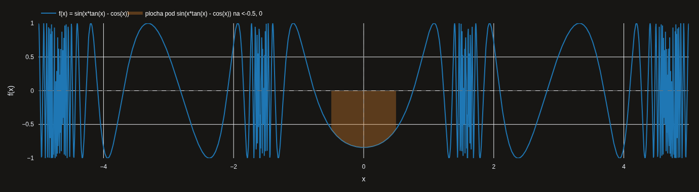

# Ukázky reálných konverzací

Přepisy níže byly vygenerovány **reálným spuštěním aplikace** (model `gpt-4o-mini`, RAG nad přednáškami FSI VUT, ověřování přes SymPy). Text matematiky je zobrazen tak, jak ho student uvidí (po normalizaci LaTeXu).

---

## 1. Režim Učitel — výklad teorie

**Nastavení:** režim *Učitel*, kapitola *3. Diferenciální počet funkce jedné proměnné*.

**🧑‍🎓 Student:** Vysvětli mi prosím, jak se derivuje složená funkce.

**🤖 Tutor:**

Derivace složené funkce je důležitý pojem v diferenciálním počtu, který nám umožňuje nalézt derivaci funkcí, které mohou být složené z více výrazu. Tento proces se nazývá pravidlo řetězce.

### Definice
Nechť $ f: \mathbb{R} \to \mathbb{R} $ a $ g: \mathbb{R} \to \mathbb{R} $ jsou dvě funkce, které mají derivace v bodě $ x_0 $. Pokud $ g(x_0) = y_0 $ a funkce $ F = f \circ g $ (tedy $ F(x) = f(g(x)) $), potom platí:

$$
F'(x_0) = f'(g(x_0)) \cdot g'(x_0)
$$

### Vysvětlení pojmu a intuice
Toto pravidlo říká, že abychom vypočítali derivaci složené funkce $ F $, musíme:
1. Zjistit, jak rychle se mění vnitřní funkce $ g $ v bodě $ x_0 $ (to je $ g'(x_0) $).
2. Potom zjistit, jak rychle se mění vnější funkce $ f $ v bodě $ g(x_0) $ (to je $ f'(g(x_0)) $).
3. Výsledek těchto dvou derivací vynásobíme dohromady, protože změna v $ F $ je ovlivněna oběma funkcemi.

### Příklad
Pojďme si ukázat konkrétní příklad:

Mějme funkci $ F(x) = \sin(3x^2) $.

1. Určíme vnitřní a vnější funkce:
   - Vnitřní funkce: $ g(x) = 3x^2 $
   - Vnější funkce: $ f(u) = \sin(u) $ (kde $ u = g(x) = 3x^2 $)

2. Nejprve spočítáme derivace:
   - Derivace vnitřní funkce $ g $:
   $$ g'(x) = \frac{d}{dx}(3x^2) = 6x $$

   - Derivace vnější funkce $ f $:
   $$ f'(u) = \frac{d}{du}(\sin(u)) = \cos(u) $$

3. Aplikujeme pravidlo řetězce:
   $$ F'(x) = f'(g(x)) \cdot g'(x) = \cos(3x^2) \cdot 6x $$

Takže bychom dostali:
$$ F'(x) = 6x \cos(3x^2) $$

### Časté chyby
1. **Zaměnění pořadí derivací** – Je důležité brat v úvahu vnitřní a vnější funkci, abychom správně použili řetězové pravidlo.
2. **Nepoužití řetězového pravidla** – U složených funkcí se často zapomíná na aplikaci pravidla řetězce, což vede k chybným výsledkům.
3. **Zapomnění na správné derivace** – Je třeba si dávat pozor na derivace funkcí sinus, exponenciálních funkcí a dalších, abychom dostali správné odpovědi.

Orientační porozumění složeným funkcím a derivacím je nezbytné pro úspěšné zvládnutí diferenciálního počtu, takže se neváhejte ptát na další detaily nebo příklady!

> 📚 *Použité pasáže z přednášek (RAG):* ### 11 Implicitní funkce, diferencovatelná zobrazení mezi prostory vyšší dimenze, ### 14 Derivace, ##### Pˇrehled vzorc˚u pro derivaci

---

## 2. Režim Zkoušející — správný i chybný postup studenta

**Nastavení:** režim *Zkoušející*, kapitola *3. Diferenciální počet funkce jedné proměnné*.

### Krok 1 — zadání příkladu

**🧑‍🎓 Student:** Zadej mi prosím jeden příklad na derivaci složené funkce ve tvaru f(x) = x^2 * sin(x) a čekej na moje řešení.

**🤖 Zkoušející:** Urči derivaci funkce $f(x) = x^2 \sin(x)$. Čekám na tvoje řešení.

Model si nejprve spočítal správný referenční výsledek nástrojem `compute`:

```json
{
  "result": "x**2*cos(x) + 2*x*sin(x)",
  "latex": "x^{2} \\cos{\\left(x \\right)} + 2 x \\sin{\\left(x \\right)}",
  "operation": "derivative"
}
```

### Krok 2 — student odpoví chybně

**🧑‍🎓 Student:** Myslím, že f'(x) = 2*x*cos(x).

**🤖 Zkoušející:** Zkontrolujme tvoje řešení. Výpočet derivace je třeba provést pomocí pravidla pro derivaci součinu. 

Očekávám, že derivace by měla mít jiný tvar. Zkus se zamyslet, co se stane, když použiješ pravidlo pro derivaci součinu. 

Zapiš prosím znovu derivaci pomocí správného postupu.

> Zkoušející **neprozradil** správný výsledek, pojmenoval oblast chyby (zde chybějící pravidlo pro derivaci součinu) a vyzval studenta k opravě.

### Krok 3 — student odpoví správně

**🧑‍🎓 Student:** Zkusím to znovu: f'(x) = x^2*cos(x) + 2*x*sin(x).

**🤖 Zkoušející:** Skvěle! Tvoje odpověď $f'(x) = x^2 \cos(x) + 2x \sin(x)$ je správná. Výborně jsi použil pravidlo pro derivaci součinu.

Teď zkusíme mírně těžší úlohu. Urči derivaci funkce $$g(x) = \frac{\sin(x)}{x^2}$$. Čekám na tvoje řešení.

Odpověď studenta byla ověřena nástrojem `verify_equivalence`:

```json
{
  "is_correct": true,
  "difference": "0"
}
```

---

## 3. Režim Spolužák — neformálně a na přirovnáních

**Nastavení:** režim *Spolužák*, kapitola *3. Diferenciální počet funkce jedné proměnné*.

**🧑‍🎓 Student:** Vysvětli mi, co je to derivace. Nějak jednoduše, jako bys byl můj spolužák.

**🙂 Spolužák:**

Jasně! Derivace je vlastně něco jako rychlost změny funkce v určitém bodě. Když si představíš, že máš křivku, tak derivace ti říká, jak strmá ta křivka je v daném bodě.

Když třeba jedeš autem, tak rychlost, kterou jedeš, je derivace tvé vzdálenosti podle času. Pokud se vzdálenost mění rychle, máš vyšší rychlost, a když se nemění, tak zpomaluješ nebo stojíš.

Matematicky to vyjadřujeme jako limitu, která ukazuje, co se děje, když se blížíme k tomuto bodu. Takže derivace vlastně ukazuje, jak moc se funkce "hýbe" při malých změnách kolem daného bodu. Super, že?

> 📚 *Použité pasáže z přednášek (RAG):* ### 14 Derivace, ##### Pˇrehled vzorc˚u pro derivaci

---

## 4. Vykreslování grafů (určitý integrál)

**Nastavení:** režim *Učitel*, kapitola *4. Integrální počet funkce jedné proměnné*.

**🧑‍🎓 Student:** Vypočítej určitý integrál funkce x^2 od 0 do 2 a ukaž mi plochu pod křivkou.

**🤖 Tutor:**

Určitý integrál funkce $f(x) = x^2$ od $0$ do $2$ vypočítáme takto:

$$
\int_0^2 x^2 \, dx = \left[ \frac{x^3}{3} \right]_0^2.
$$

Nejprve spočítáme hodnotu:

1. Dosadíme horní mez $2$:
   $$ \frac{2^3}{3} = \frac{8}{3}. $$

2. Dosadíme dolní mez $0$:
   $$ \frac{0^3}{3} = 0. $$

3. Odečteme výsledky:
   $$ \frac{8}{3} - 0 = \frac{8}{3}. $$

Tedy, výsledek určitého integrálu je $\frac{8}{3}$.

Podívejme se nyní na plochu pod křivkou $y = x^2$ mezi $0$ a $2$:

- Oblast pod křivkou je vyznačena na grafu níže.

 

### Časté chyby:
1. **Zapomenutí na meze integrace:** Někteří studenti nezapíší dolní a horní mez, což vede k chybě.
2. **Chybně provedená substituce:** Při výpočtu antiderivace je důležité být pečlivý, zejména na koeficienty.
3. **Opomenutí odečítání mezi mezemi:** Učinit toto odčítání správně je klíčové pro získání správného výsledku.

> 📈 V aplikaci se pod odpovědí **vykreslí interaktivní graf** funkce $y=x^2$ s oranžově
> vybarvenou plochou mezi $0$ a $2$ (nástroj `plot_function` s `area_from=0`, `area_to=2`).
> Nástroj zároveň spočítal plochu ≈ **2,6667** (= 8/3), což odpovídá výsledku.
> Do stejného grafu lze zadat **víc funkcí najednou** (seznam `exprs`) a osy $x=0$, $y=0$ jsou
> vždy zvýrazněné tečkovaně.

---

## 5. Ukázka vygenerovaného grafu (náročná funkce s póly)

**🧑‍🎓 Student:** Vykresli mi graf funkce `sin(tan(x)*x-cos(x))`. Zvýrazni na tomto grafu plochu
pod křivkou na intervalu −0,5 až 0,5.



Ukázka názorně předvádí **robustní vykreslování**: funkce obsahuje `tan(x)`, který má póly, takže
se křivka v těchto místech prudce rozkmitá – přesto graf zůstává čitelný (místo roztažení osy y
na obrovské hodnoty se použije robustní rozsah a křivka se v místech skoků přeruší). Oranžově je
vybarvená **plocha pod křivkou** na intervalu ⟨−0,5; 0,5⟩ a osy $x=0$, $y=0$ jsou zvýrazněné.
